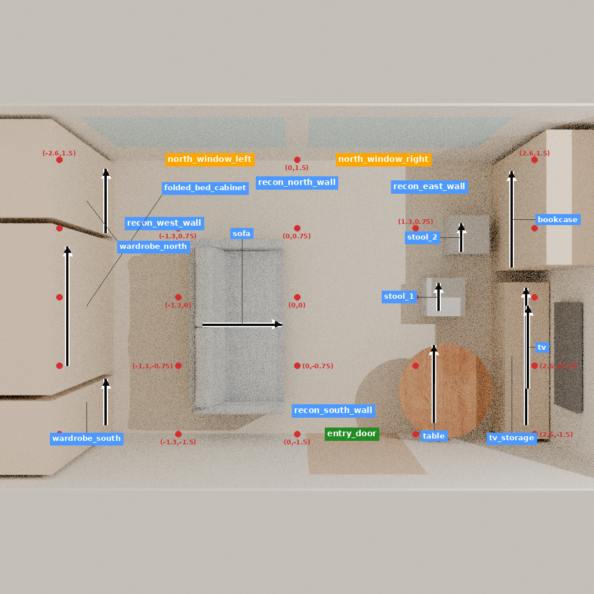
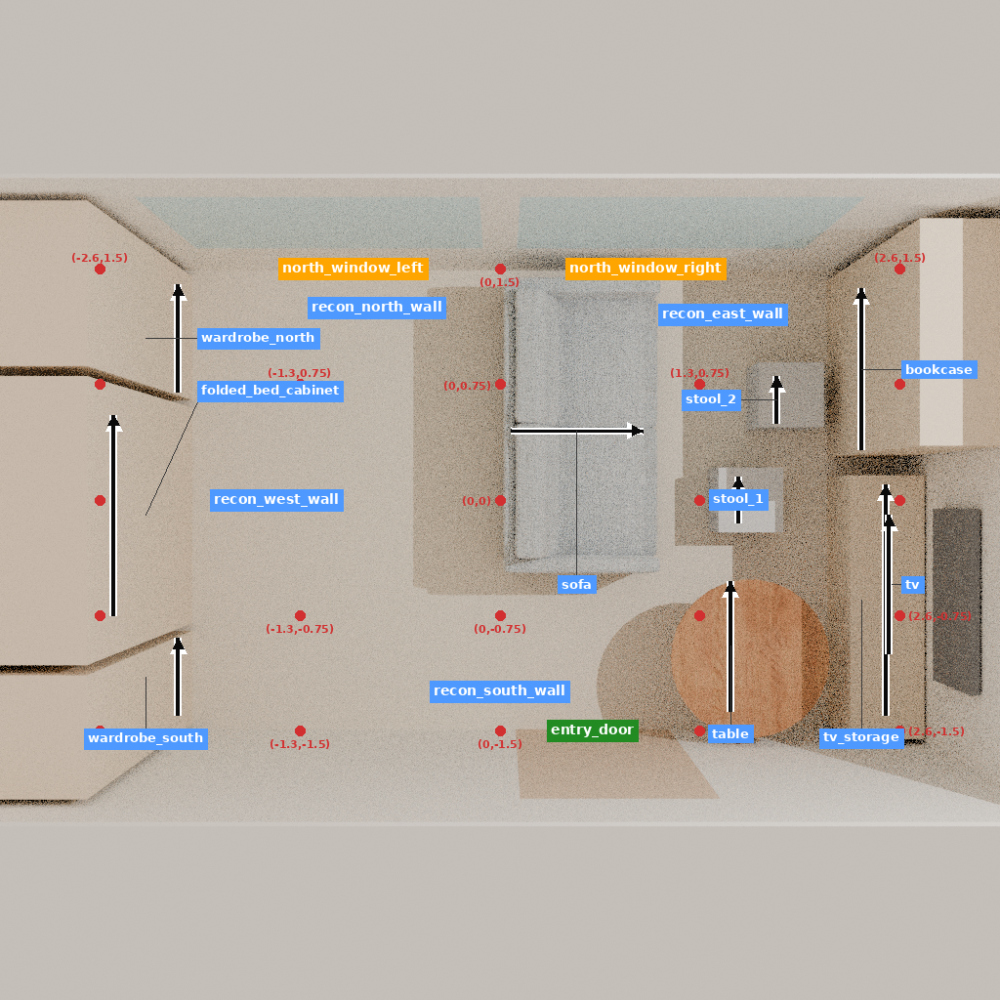

# Bukit：有来源的沙发移动重建记录

这条记录把专业决定对应到了实际对象和一次原生动作，结果有局部收益，也有用途代价；**不作为正向专业推荐或已准入的训练样本**。整体研究与训练仍未完成。

[原项目介绍](https://www.nevertoosmall.com/post/flexible-home-for-a-singapore-social-worker)支持以可移动家具适应活动变化。它没有提出保留业主旧沙发的身份约束；本回放保持对象 ID 是研究者的实现约束。详细来源、对象映射、假设、动作及结果在 [DECISION_PACKET.json](DECISION_PACKET.json)。原始四条知识记录的冻结版本在 [SOURCE_PACKET_AT_FREEZE.json](SOURCE_PACKET_AT_FREEZE.json)，其哈希与构建计划一致。

## 重建和实际执行

主房间假设为 5.2 × 3.0 × 2.6 米，包含起居、餐饮／工作和折叠床柜体的静态表示；厨房、浴室、防空室及外侧走廊未建模。原文 38 平方米是整户面积，不是本房间的实测面积。初态、坐标及动作顺序均为研究重建，不能称历史改造前状态或设计师操作轨迹。

保留 10 件家具／代理物、17 个原生对象。沙发和桌子用未缩放的 HSSD 资产，其余为 8 个明确标注的静态代理。原项目为轻型双人沙发，替代资产名称为 FRANK 3 SEATER；它的尺寸、质量、坐席与搬运难度不代表原家具。桌轮、凳子堆叠、床折叠、柜内容量均未验证。

对 `recon_sofa_0` 执行一次 `move_furniture_tool(x=0.5,y=0.45,yaw=-90)`。实际位姿带有原生工具的小幅噪声，详见 [STEP.json](STEP.json)。其余对象和全部实例 ID 未变。前后实际状态、十张状态绑定视图和检查点均已保存；仓库提供两张俯视图，完整资源留在服务器。

| 条件量测 | 移动前 | 移动后 |
| --- | ---: | ---: |
| 指定 2.73 m² 平面预留区内未被 AABB 占用面积 | 1.3892 m² | 2.7300 m² |
| 房间内最大轴对齐空矩形 | 3.3744 m² | 5.9200 m² |
| 0.4 m 方形身体包络可达接近点 | 6/8 | 2/8 |
| 0.5 m 方形身体包络可达接近点 | 5/8 | 2/8 |
| 0.6 m 方形身体包络可达接近点 | 3/8 | 2/8 |

0.4 米情形失去床脚、书架、沙发前方和窗前接近点；桌边和电视柜接近点原本已不通过。以上采用 2 厘米网格、1.8 米身体净高、保守 AABB 和门扇假设开启；它们是条件化诊断，不是人体试验或规范验收。平面预留区清空不证明床能展开或人能睡下。所测直线扫掠未碰其他障碍，但工具为瞬移，未验证搬运过程。

## 尺寸敏感性及重建缺陷

预先固定长度 4.8/5.2/5.6 米、宽度 2.8/3.0/3.2 米，保持资产尺寸不变，按声明的墙边锚定规则计算九个组合。仅中间尺寸有实际原生回放，其余八个是 AABB 解析反事实，不能作九个独立实验。

九种组合均增加了预留区未占面积，六种完全清空。长度 4.8 米时三种宽度仍有占用；宽度 2.8 米会出现家具包络重叠。所有组合都保留了初态西侧柜体超出墙内表面约 1 厘米的重建缺陷。因此不能把本记录标成几何合格或整屋可用。结果不能反驳真实项目，因几何、家具和活动条件均有重建差异。

当前用途是条件化问题识别、状态变化与副作用解释，以及来源到实际动作的对应记录。独立专业评价、正向动作训练和跨项目学习结论仍不具备证据。

## 执行成本与复核

构建／重新加载 5.736 秒，exit 0。首次接口初始化未建立会话或执行动作，211.927 秒后终止，exit −15，原始记录保留。事前登记的恢复只切换至此前使用的本机软件渲染环境，场景、动作和一步工具预算未变；第二次实际回放 84.839 秒，exit 0。九格敏感性 0.618 秒，exit 0。各阶段总计约 303.120 秒，0 次模型调用、0 次训练。

[VALIDATION.json](VALIDATION.json)记录初态原生恢复、四项回放检查、十张视图绑定，以及终态检查点 27 个资源文件的哈希核验。最终检查点未额外做一次冷加载。[SERVER_ARTIFACTS.json](SERVER_ARTIFACTS.json)记录本机路径、哈希和恢复方法；含前后 GLB 的全运行服务器产物约 96.0 MB，没有提交网格或完整检查点。

实际命令逐项见 `execution/*/receipt.json`；构建和回放计划及执行代码均已归档。重现初态使用 `code/build_reference_room.py` 和 `BUILD_PLAN.json`，原始资产按计划中的仓库、revision 和 SHA 恢复。需要完全相同的终态时使用已保存检查点，不能重新调用带噪声的移动工具后要求字节相同。`SOURCE_PACKET_AT_FREEZE.json`保留构建时的知识版本，索引后续更新不会改写它。

另已导出前后两个可查看 GLB，均包含 10 个家具／代理物和房壳，节点保留对象 ID。导出后重新读取并核对节点、三角数和包围盒；材料逼真度不在本次验收内。文件路径与 SHA 见 SERVER_ARTIFACTS.json，网格不进入 Git。
