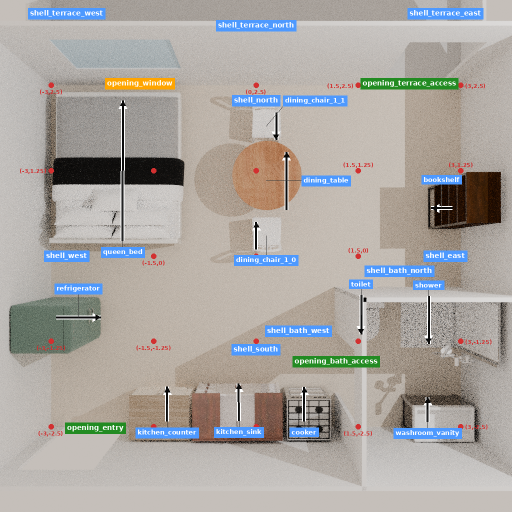

# 同一Casa任务的研究者参考方案

在原房壳、16项未缩放目录和原生工具上，12次添加得到12件家具/设施。真实执行98.969544秒、退出0，零模型调用、零训练。所有结构与开口保持原样，完整三角网格审计检测到0组相交、0越界，三件卫浴设施均在固定卫生间内。

| 证据 | 实际结果 | 能说明什么 |
|---|---|---|
| 必要资产 | 床；冰箱、操作台、水槽、灶具；马桶、淋浴、洗手台；书架；桌和两把椅子 | 同一目录可以补齐这些角色，不代表实际功能全部成立 |
| 原固定通路 | 卫生间内与露台内接近点，三体宽均可达 | 本参考解决了之前测得的固定通路阻塞 |
| 事前声明的13个用途接近点 | 0.4/0.5/0.6米均13/13可达 | 仅支持该网格、方形身体与目标点下的条件通行 |
| 原通用前侧点 | 床左侧、桌前、两椅前均不可达 | 床一侧靠墙；桌椅前侧点互相落入占用，保留原审计，不把它们删成通过 |
| 可恢复性 | 原生新进程加载通过，12回执及ID/资产一致 | 原生状态与操作链可追踪；恢复后继续编辑未另试 |
| 三维导出 | GLB往返边界误差约1.91e-7米 | 可分享的几何结果，非安装、材料或真实人体验收 |

方案及用途接近点在三组模型结果之后由研究者构造、在本次执行前冻结。只允许一条12步方案，没有模型生成或专业作者理由；它不是模型改进，也不是原项目历史设计，不进入训练和封存测试。只保存初末两组五视图及每步实际状态，不能称为完整逐步视觉OTA训练序列。

这份结果反驳“目录里没有必要设施”或“24次工具预算连角色都不可能补齐”的解释。它没有证明完整真实住宅可用，也没有证明配对训练有效或无效。座椅真实进入/落座、桌面工作与用餐面积、冰箱/柜门开启、卫浴隐私与安装、容量、舒适和专业偏好仍未验收。

下一步应将共有建设动作补到已登记训练来源中，在确有专业证据的决定处配理由，并保留强提示/同知识检索参照。Casa已暴露，继续作为开发诊断，不能把参考坐标或理由回灌成独立测试收益。
