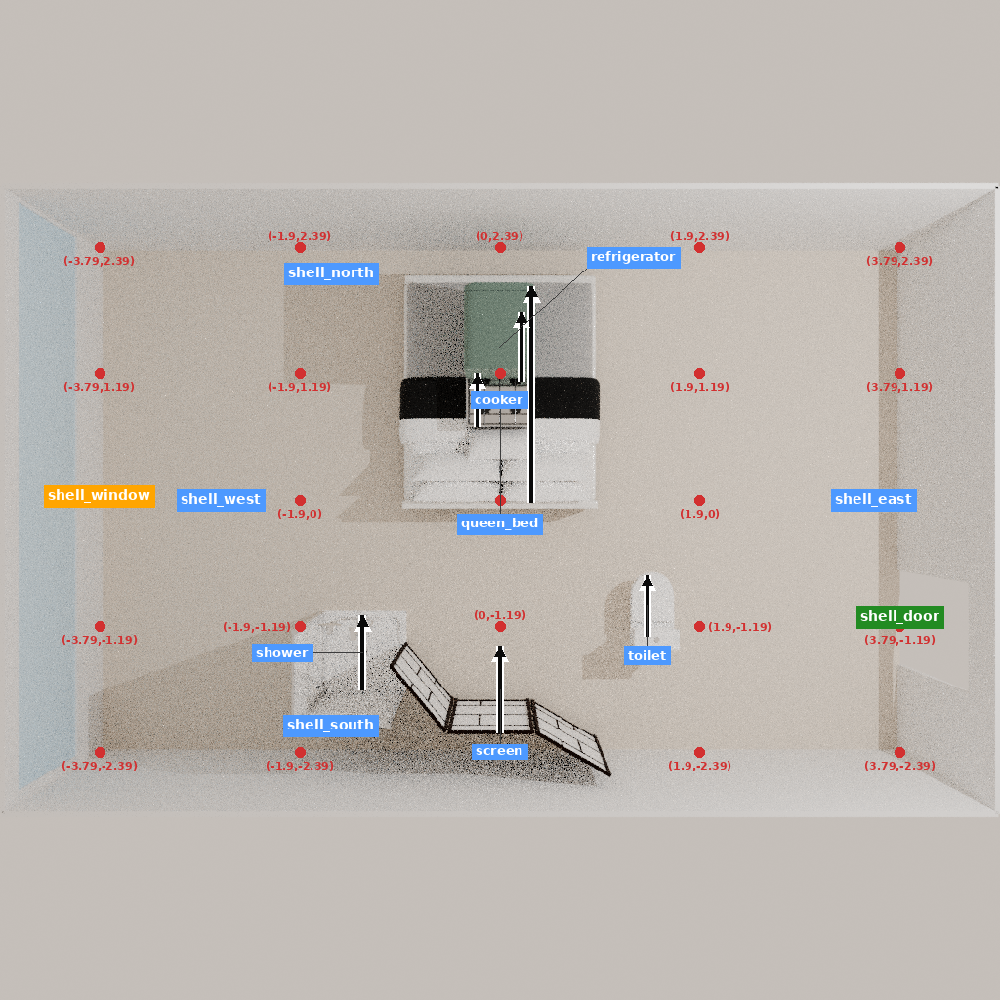
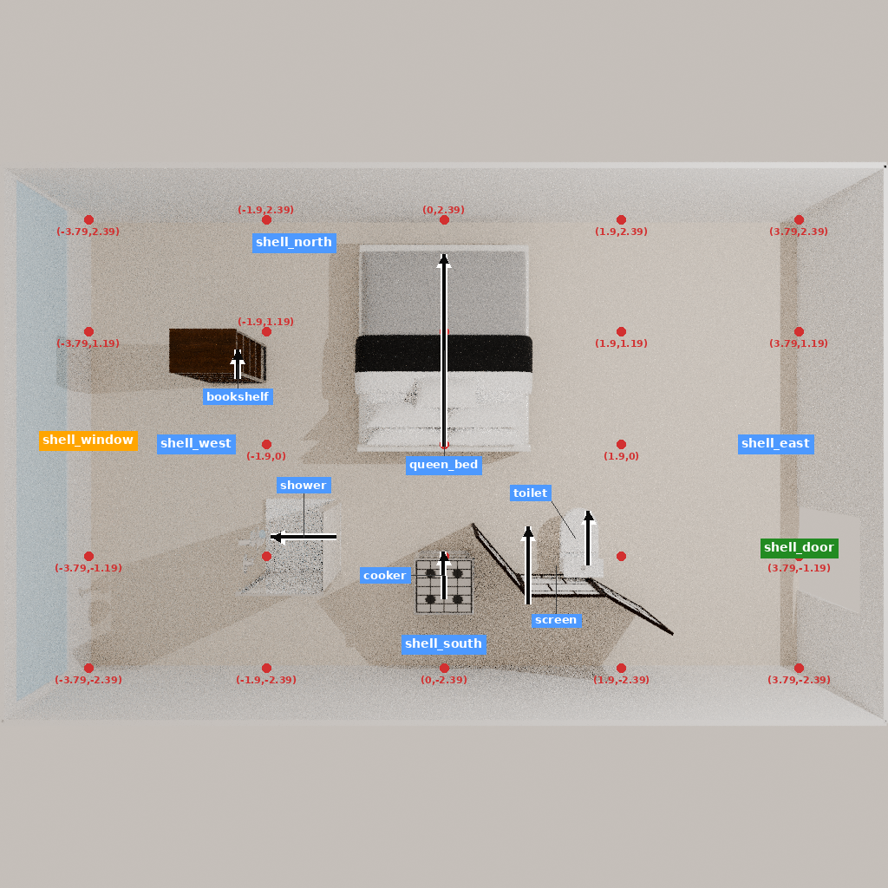

# 同一部分房间的几何／用途反馈对照

两组从 WHOLE-v2 的同一 step15 检查点出发，各最多再用 9 次动作；此前 15 次动作是共享成本。G 接收几何检查，U 另接收条件通行和功能清单反馈。两组均未训练。

| 项目 | G | U |
| --- | --- | --- |
| 新增模型调用 | 9 | 9 |
| 新增实际工具调用 | 9 | 9 |
| 最终家具数 | 6 | 6 |
| 实际视觉网格相交对数 | 4 | 0 |
| 越界家具数 | 0 | 0 |
| 原始结构记录保持 | True | True |
| 仍缺的目录功能指示项 | living_seating, food_preparation_surface, kitchen_sink, washbasin, storage | living_seating, food_preparation_surface, kitchen_sink, cold_food_storage, washbasin |
| 实际退出码 | 0 | 0 |
| 生成 token | 514 | 682 |

完整住宅尚未验收。家具数量、朝向、空地面积或工具成功不能替代用途与隐私检查；删除所需功能造成的几何改善不记为设计收益。

共享初态有 6 件家具、2 对实际视觉网格相交。条件通行在 0.4／0.5／0.6 米方形身体假设下分别为 5/7、3/7、2/7 个接近点可达；它们不是活动成功率。

[完整比较与逐步动作](COMPARISON.json) · [冻结协议](RUN_PROTOCOL.json) · [初始配对核验](PAIR_INPUT_AUDIT.json) · [G 结果](G/SUMMARY.json) · [U 结果](U/SUMMARY.json)

COMPARISON 的 conditional_target_lifecycle 将初态和两终态的接近点取并集逐项展示。被删除物体的接近点记为缺失，不从共同表中消失；新增目标与原目标分开识别。各终态的可达点比例因对象增删而分母不同，不能直接当作可比的使用成功率。

两组实际首请求的共同内容再次逐字核对。U 增加输入信息和 token，因此不宣称计算量完全相同；此单开发房间对照不提供统计优越性、学习或跨项目泛化证据。

原生四元数冷恢复的极小舍入逐项记录；原五视图按已有 ≤1e-12 分量差规则复用，其他状态字段完全相同。先前 v1 的精确哈希拒绝与 0 次模型结果完整保留。

原始状态、全图、网格和检查点留在服务器；路径与哈希见 SERVER_ARTIFACTS.json。实际命令及退出码见 COMMANDS.json，恢复位置见两组 RESUME.json。

终态可恢复性另经实际原生会话核验：G/U 分别13.414／13.314秒退出0，各10项检查通过；没有新增模型、工具动作或渲染。两份GLB重新打开后各23几何节点保持，最大包围范围差约1.06e-7米；这是几何预览，材质与设施功能仍未新增验收。见两组 TERMINAL_RESTORE_RESULT、GEOMETRY_EXPORT_RESULT 与 [完整成本账](COST_LEDGER.json)。
