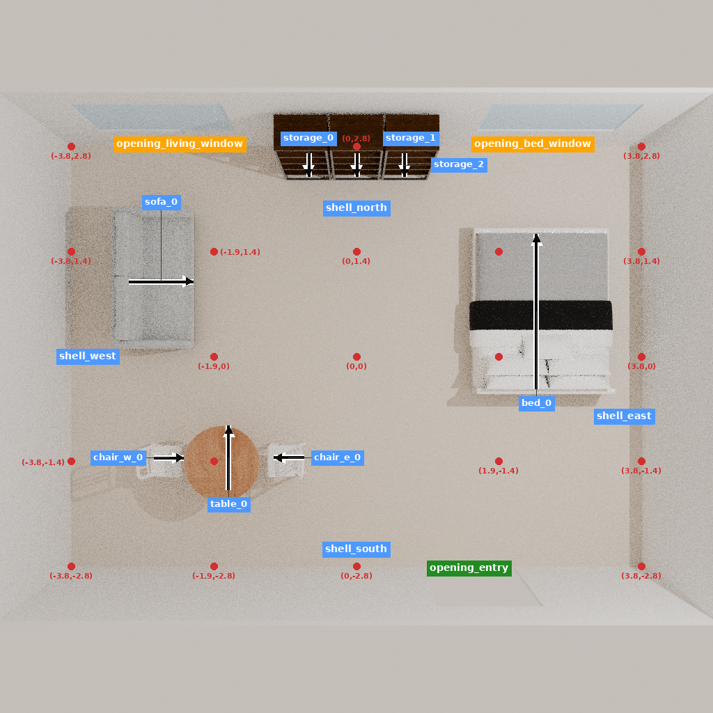
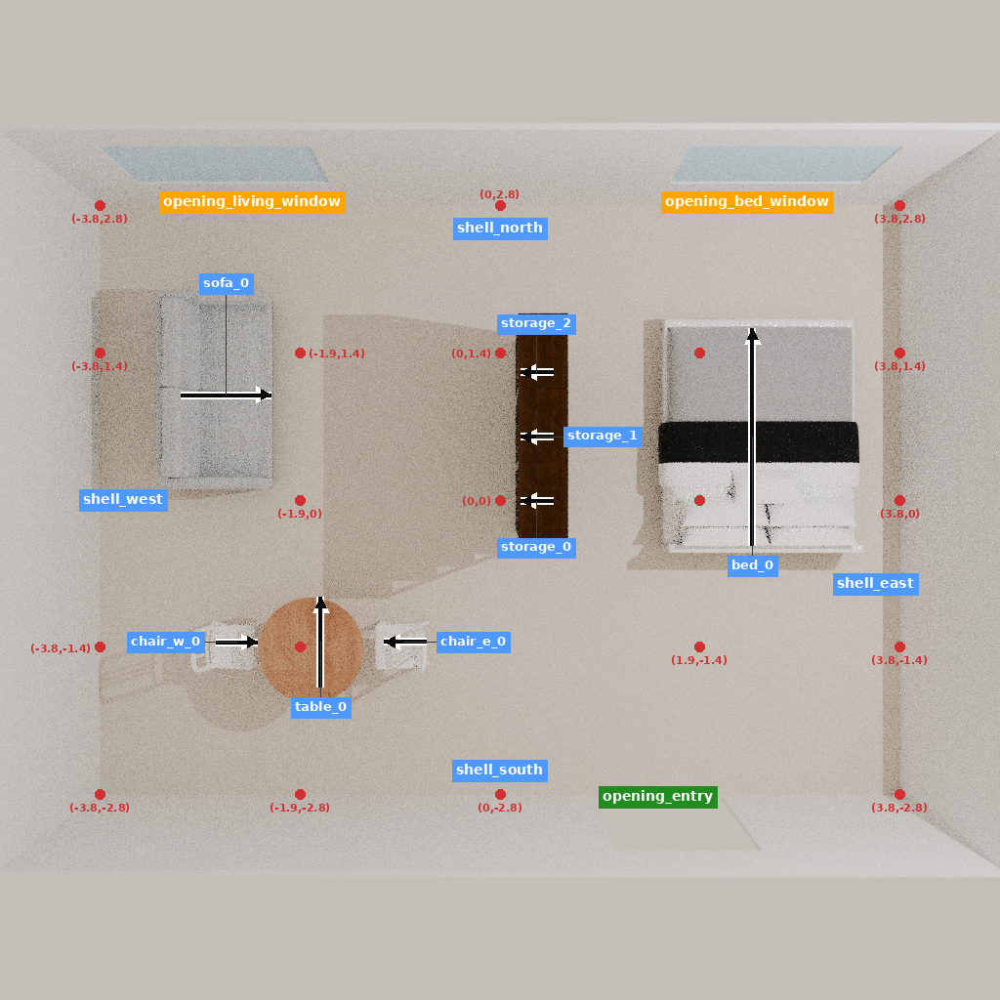
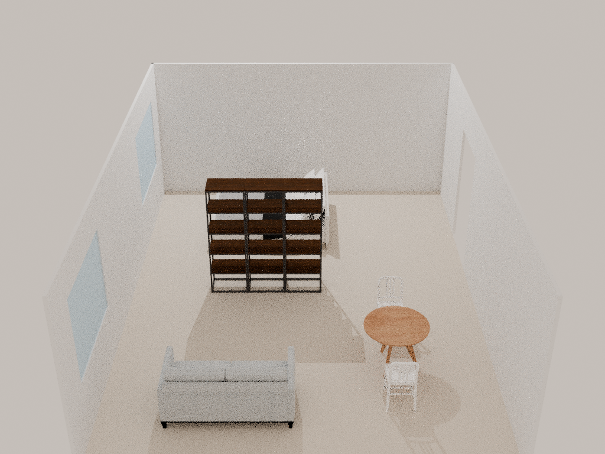

# Flinders：已执行的分隔尝试未通过，模型对照未启动

本次把已有三件书架移到睡眠与起居区之间，实际执行了三次原生移动。它没有达到冻结的遮挡要求，不能作为正向专业示范，也不能据此比较模型。两份预先冻结的推理计划均未启动：0 模型调用、0 训练更新。

| 检查 | 原位靠墙 | 实际分隔终态 |
|---|---:|---:|
| 保留家具 ID、资产及尺寸 | 8/8 | 8/8 |
| 27 条实际网格采样视线中畅通数 | 27 | 18 |
| 九个要求接近点，0.4/0.5/0.6 m 方形身体代理 | 各 9/9 | 各 9/9 |
| 双人餐位静态代理 | 三宽通过 | 三宽通过 |
| 实际网格表面相交对 | 0 | 1 |
| 家具越界 | 0 | 0 |
| 模型调用 | 0 | 0 |

初态满足本任务的开放条件；分隔终态仅挡住 9 条视线。西、东视图可见书架为开放框架，不能凭其包围盒或“高柜”类别假定能遮挡。storage_0 与 storage_1 存在三角网格表面接触，Y 轴包围盒重叠约 0.862 mm；这不是实测穿透深度。预检理想位置无此接触，原生落位存在小偏差，实际状态是评价依据。只保留端点可达不代表通行代价没有变化：0.5 m 代理的可达地面中心面积从 21.9976 降到 20.8832 平方米。

[来源](https://www.archdaily.com/525243/flinders-lane-apartment-clare-cousins-architects)支持以定制通高柜体分隔睡眠和起居、提供双面收纳。当前 7.6×5.6×2.7 m 房间、需求、普通书架和动作均为研究者迁移重建；没有复现原项目 75 平方米住宅或双面定制柜体。原项目知识已经看过，不能称封存测试。构建程序沿用的日志短语“held-out input”不准确，判定以 SOURCE、manifest 与本说明为准。

v1 因床侧窗接近点失败而关闭，0 动作；v2 在模型调用前明确修改床位及候选柜间距，见 INPUT_REVISION。v2 是唯一允许的修订，实际结果出来后没有再调位置、换资产或改视线门槛。冻结协议要求两种条件均有通过的参考，故连初态已满足的 open 模型单元也没有单独启动。未证明其他书架排列必然失败，更没有得到模型/学习的负结果。

主要证据：

- [决定记录](DECISION_PACKET.json)：来源 → 假设 → 对象 → 实际动作 → 房间 → 收益、代价与未知。
- [结果表](RESULT_TABLE.json)、[原始审计](CANDIDATE_AUDIT.json)、[可行性判定](FEASIBILITY_GATE.json)、[汇总](SUMMARY.json)。
- [实际动作与回执](evidence/native/STEPS.json)、[完整终态](evidence/final/house_state.json)、[恢复/三维文件说明](RECOVERY.md)。
- [全部实际阶段命令](COMMANDS.json)、每阶段 receipt.json 中的真实起止时间、首日志及退出状态。

三次移动耗时 167.92 秒，进程 exit 0；设计可行性未通过。20 张观察图全部保留在服务器，Git 收录初末各五视图及两张中间俯视图。最终场景冷恢复通过，3 条回执/16 项目录/8 家具身份和状态一致；恢复过程不再次编辑。GLB 为 14,575,424 字节、31 节点，重载边界最大误差约 1.14e-7 m，大文件留服务器。

这条记录适合来源知识、替代资产适用性和客观后果分析，不进入正向动作训练集。真实隐私、收纳容量、双面取用、稳定性、搬运过程、人体使用和独立专业评审均未验收。后续应把已有可行决定组成连贯学习试验；不再靠新增房间、窄坐标搜索或追加训练挽救本例。
