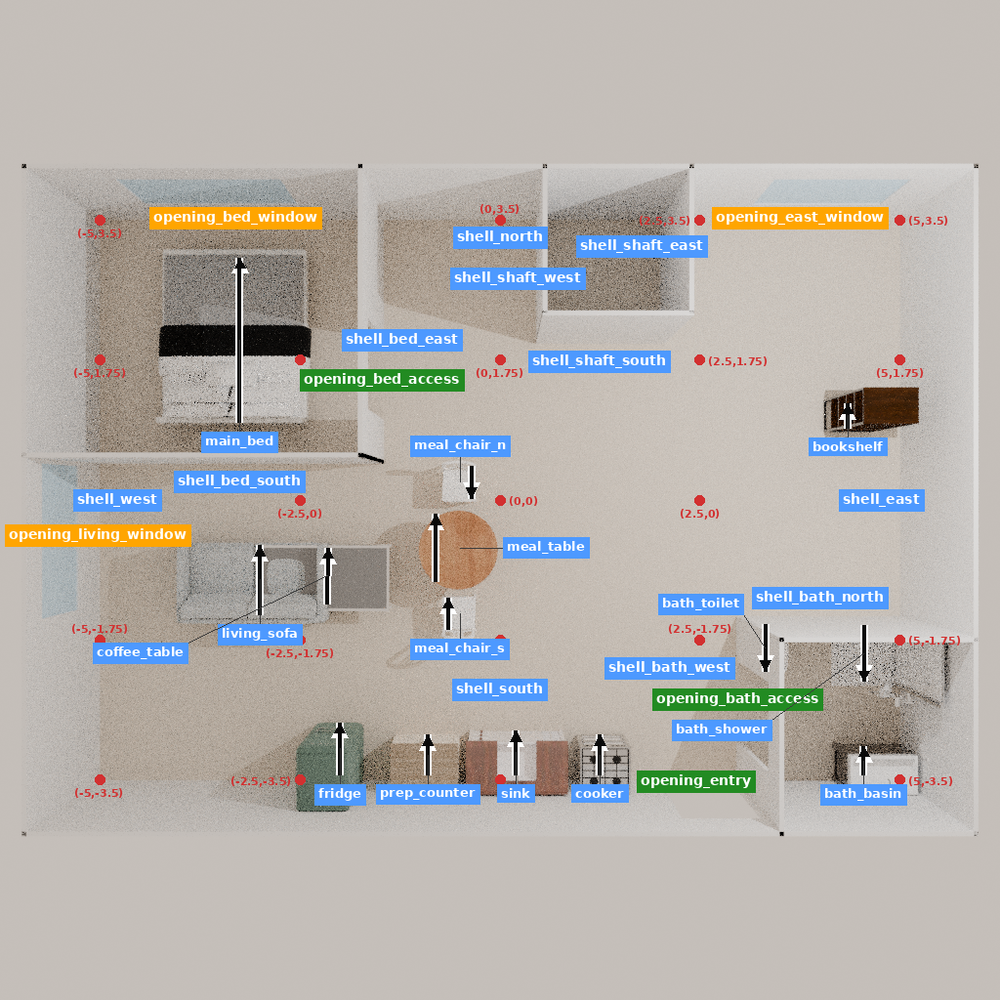

# 米兰居住兼办公任务：冻结底座失败诊断

本次实际运行停止并已完成独立核验：**7次模型调用、6次工具尝试、4次场景改变，0训练**。第7次输出达到1024-token上限而未形成完整动作，未执行，按冻结规则退出，不重启。真实运行为2026-11-05 23:01:01.903080至23:08:00.618269 UTC，418.715213秒，退出码1。

输入是上一批已准备的13家具住宅及原任务，来源家族为`milan_home_office_set_architects`。它是声明研究假设的迁移任务，不是米兰原住宅的测绘复原。分析者已接触来源成品，不能称封存测试。来源/参考末态均禁入模型、训练和检索；只复用与初态绑定的五图。初始14111tokens，七次输入均未超过16384且未截断；底座固定revision `63e235a0c0d6e5bc2f8f3485214df4457fd2e672`，BF16、无adapter、仅GPU0。

## 实际决定与后果

| 顺序 | 模型输出及实际结果 | 解释 |
| --- | --- | --- |
| 1 | 状态查询成功，但把schema放进arguments | 原生接受不等于符合工具schema；不是编辑。 |
| 2 | 删除`retained_shelf_0`成功 | 违反原实例保留要求。 |
| 3 | 添加同资产的`bookshelf_0`成功 | 新实例不能代替已要求保留的旧实例。 |
| 4 | 移动`living_sofa_0`成功 | 后续评价随实际位姿重新定位用途点。 |
| 5 | 添加`coffee_table_0`成功 | 终态与沙发有一对实际网格表面相交。 |
| 6 | 删除不存在的`retained_desk_0`失败 | 计入工具预算；没有场景改变。 |
| 7 | 未闭合的查询输出达到1024tokens | 原文保留，没有第7次工具执行。 |

终态14件家具，原13实例保留12件，固定结构/床/设施记录保持不变，0越界。预定14个动态用途目标在0.4/0.5/0.6m方形通行假设下，初态均14/14，终态分别13/14、12/14、12/14；缺失原书架目标始终留在分母，较宽两种假设另有南餐椅侧方不可达。旧固定探针审计中的`sofa_front`坐标不能当作移动后沙发的用途点；主解释使用`EVALUATION.json`。

没有找到预定义的独立办公桌椅组合。共享餐桌、茶几或沙发是否能满足真实办公未被完整评价，不能由此宣称所有共享方案都不可能。原西侧书架不再遮挡窗投影，但丢失身份这一事实不能被局部空间变化抵消。舒适、采光、收纳容量、设施使用和整屋专业评价仍未知。

## 证据与恢复

- `PLAN.json`、`EVALUATION_PLAN.json`：模型输出前冻结的输入、预算、评价和代码哈希。
- `SUMMARY.json`、`INTERPRETATION.json`：结果、成本、失败与解释边界；`ACTION_SCHEMA_REVIEW.json`保存逐次动作和回执。
- `rollout/round_*/`：实际请求、原文输出、编码、回执；`execution/`保存真实命令、首日志、启动/结束和退出码，包括失败。
- `ARCHIVE_CHECKS.json`：7组观察/35图实例的解码、哈希、状态绑定；5种不同原生状态。最终五图已目视检查，见`VISUAL_REVIEW.json`；中间图未宣称专业审阅。
- `TERMINAL_SELECTION.json`：最后真实检查点是`round_005/checkpoint`。失败作业没有生成名为`final_checkpoint`的最终检查点。
- `cold_restore/RESULT.json`：新进程核对全部资产、身份及6条回执，两个四元数末位约1e-19差异；不是逐字节完全相同。9.047005秒/退出0，无编辑、模型或渲染。
- `export/RESULT.json`：60几何节点、23,869,956字节GLB，SHA256 `0bb193735c70fe07fdda275ea20d646797b32e2b0496e7a7e06c3af106d344f7`；边界往返误差约2.12e-7m。大文件和完整检查点留服务器，见`RECOVERY.md`。

成本包括103487输入tokens、1378输出tokens、33.068秒模型加载和93.265秒生成；峰值allocated 21,502,714,368字节，reserved 22,542,286,848字节。每次调用重新加载模型的开销已计入。准备57.113秒/0，终态用途评价5.285秒/0，网格审计5.436秒/0，导出13.012秒/0，归档0.517秒/0。

评价程序在推理前用已有参考校准：首次因误写`final_checkpoint`路径退出1，第二次使用实际`checkpoint`成功，5.535秒/0，代码和评价阈值未改，原生场景没有重跑。失败记录均保留。

这支持的是**本预算下的未完成与具体要求损害**，不是专业学习、配对训练增益、训练必要性或跨项目泛化证明。停止本案追加推理，将负结果纳入研究证据。

