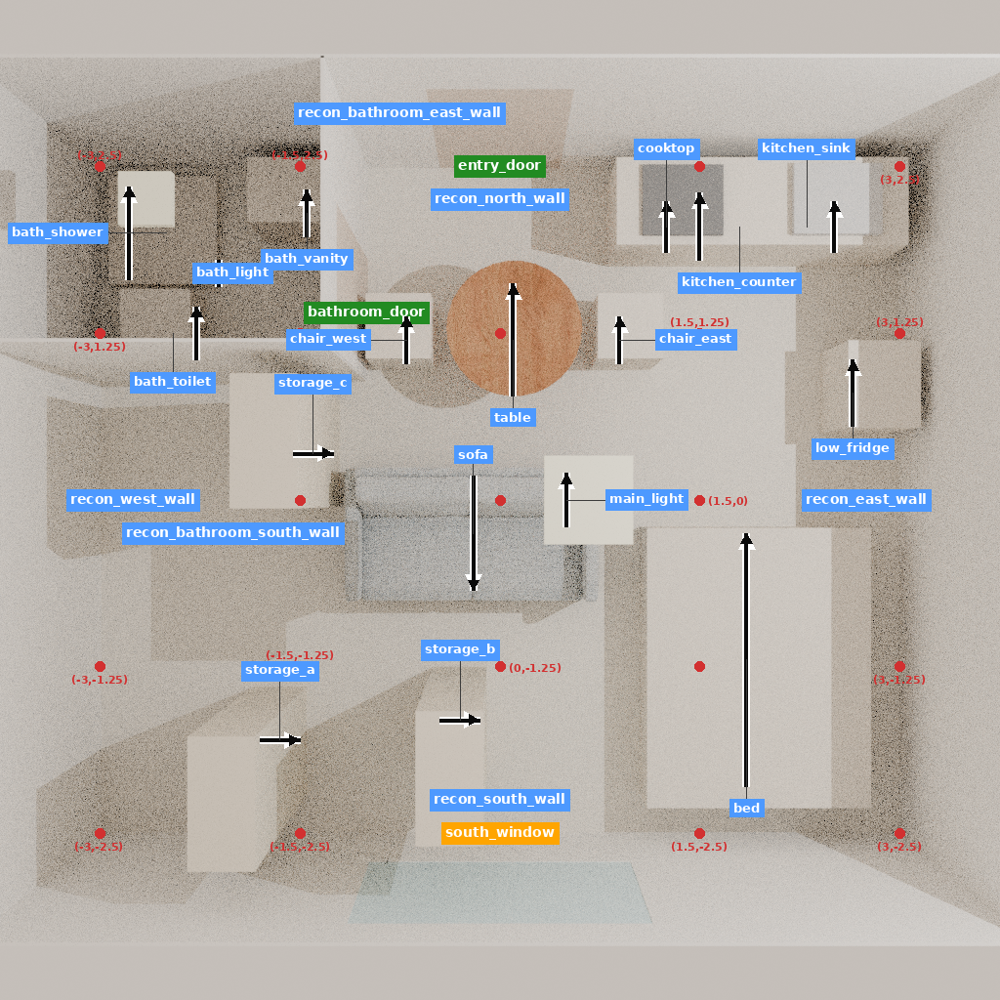
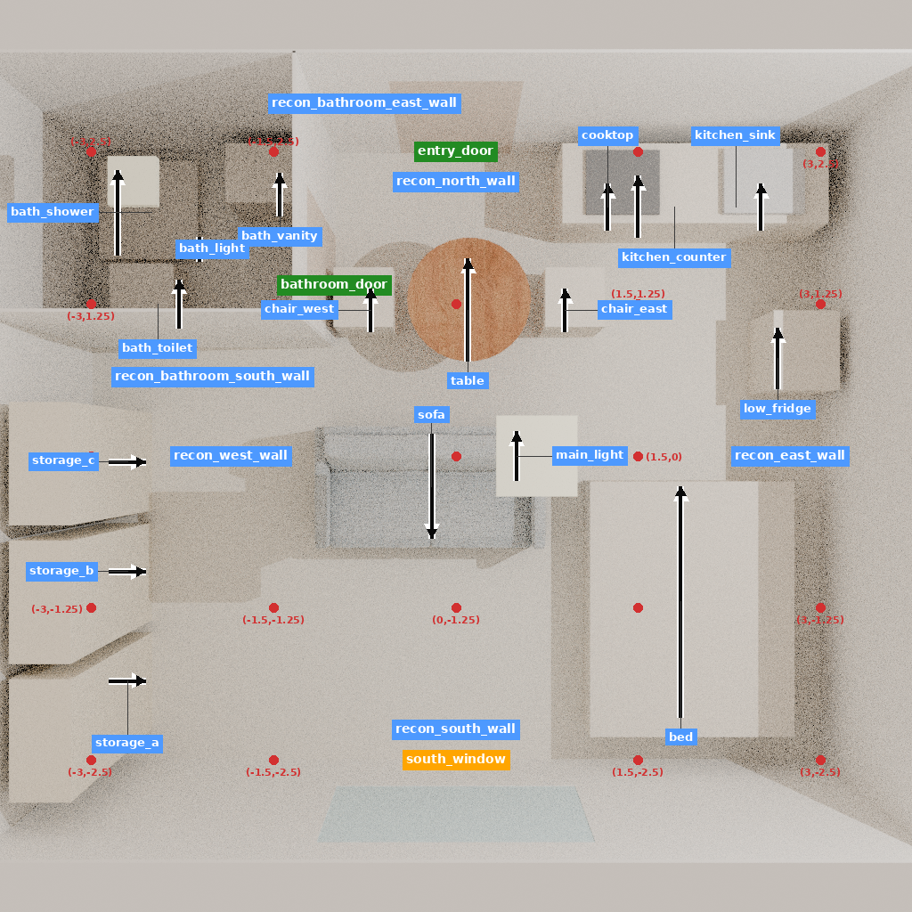

# Guilbault 来源原则的迁移回放：局部空地增加，通行验收未通过

五次原生移动、六组五视图和前后三维导出已经完成。三件柜体集中到房间西侧后，声明起居区空地增加 **0.88 m²**，但三种代理宽度下，前后七个活动点均为 **0/7** 可从入口到达，柜前采样点均为 **0/15**。因此本例是完整、可审阅的来源对应**诊断记录**，不能列为正向整屋设计监督。

**结果解释以 `SUPERVISION_QUALIFICATION.json` 为准。** 最初 `SUMMARY.json` 的冻结规则只检查空地增加及接近数“不变差”，因此给出了 `conditional_rule_passed=true`。零到零使这条规则失去功能验收意义。原规则、原汇总和初次导出均保留，不能用这个true证明房间可用；修正后的客观QA已明确写出全零接近与初态缺陷。

## 专业来源与迁移范围

[Richard Guilbault 的建筑师项目说明](https://www.archdaily.com/623445/30m2-flat-in-paris-richard-guilbault) 将约30平方米住宅的储物和技术需求集中在一面多用途长墙，同时重组起居与私密空间。来源包括设备整合与完整改造，不能通过移动三个箱体宣称全部复现。

本例仅迁移“将储物集中到房间一侧、减少对主要活动区的占用”这一可表达部分。三件柜体是研究者定义的0.8×0.4×2.2米外包络，有稳定对象ID、声明正面，无柜门、内部容量或原工程设备。初态、尺寸、位置、五步次序和活动点均由研究者构造，不是原始任务书或历史操作。6×5×2.6米房壳、西北卫浴及一扇窗沿用既有研究模板；与AIR共享模板，不能计作独立测试。原项目四窗采光、技术安装、施工、储物容量和专业偏好均未验证。

该来源家族在2026-11-05T04:00:13.748299Z已分配为未来训练来源候选；本轮在05:52:38Z冻结输入、五步程序及预算后才构建和执行。使用既有两件网格资产和15个家具/灯具代理，无下载、模型推理或训练。

## 实际结果

| 指标 | 初态 | 终态 | 可说明的范围 |
|---|---:|---:|---|
| 声明起居区内未占用包络面积 | 5.843312 m² | 6.723312 m² | 局部平面几何增加0.88 m² |
| 全屋最大轴对齐空矩形 | 3.7632 m² | 6.1248 m² | 未证明该矩形可达或适合活动 |
| 入口到七个活动点，0.4/0.5/0.6米 | 0/0/0 | 0/0/0 | 原有通行缺陷持续存在 |
| 入口到15个柜前点，同三宽度 | 0/0/0 | 0/0/0 | 不能声称柜体实际可使用 |
| 入口连通中心区域，同三宽度 | 0.6016/0.3808/0.2376 m² | 相同 | 入口格为空，但仅连接小范围 |
| 原对象保留 | 26 | 26 | 三柜ID/包络保留，其他23对象逐字段不变 |

第一次移动后最大空矩形曾从3.7632降至3.4104 m²；全部中间状态和指标均保留。所有调用通过原生工具，实际微小位姿偏差用于量测，未用请求坐标代替终态。

入口附近的西餐椅、餐桌和厨房台未移动。椅—桌包络间距约0.10米、桌—厨房台最短平面间距约0.238米；按0.4/0.5/0.6米方形代理膨胀后相连，构成入口瓶颈的一部分。此诊断限定于保守包络，不证明真实人体无法通过，也不否定原建筑师的设计原则。问题首先出在研究者重建的初态。

## 执行与数据用途

构建5.735818秒/退出0；单条轨迹预检0.517423秒/0；原生回放268.389955秒/0（05:53:55.011957Z至05:58:23.401898Z）；汇总1.019242秒/0；资格复核0.567768秒/0。两份GLB各42几何节点，回读最大边界差约1.16e-7米，导出各约2.826秒/0。命令、首日志、真实启动/退出状态见 `execution/`。

- `DECISION_PACKET.json`：来源、重建假设、对象、五步执行、前后房间、后果和资格结论。
- `SUPERVISION_QUALIFICATION.json`：为什么不能把弱规则通过当功能成功；正向设计OTA准入为0。
- `OBJECTIVE_REVIEW.json` / `QA_EPISODE_CANDIDATE.json`：可用的客观问题识别记录，非独立设计师评价。
- `ota_candidates/`：五个真实机械编辑候选，每个绑定当时的状态和五图，保留未来后果在评价字段；它们属于同一决定，**未准入正向设计训练**，未重新运行官方加载器或训练。
- `AIR_SUPERVISION_AUDIT.json`：AIR的短住开放挂衣理由有专业来源；后续衣架移动主要由几何反馈决定，不足以单独检验学到该专业理由。
- `pre_interpretation_export/`：最初的派生解释与导出，供核对纠错过程；不是另一次实验。

可以保留专业知识、合法动作回放和诊断QA，不必把它们全部记成零；正向设计监督和训练授权仍分别审核。本轮没有新的人评、学习效果或跨项目泛化证据。下一步先使重建初态具备有意义的活动覆盖，再冻结后续决定；本次五步轨迹不加预算重调。

## 可查看产物

可编辑原生检查点为服务器运行目录 `replay/checkpoint_5/`；完整GLB为 `export_initial/room_geometry.glb` 与 `export_after/room_geometry.glb`。六组状态绑定图、每步前后状态及回执、五个检查点、大型网格留服务器；`SERVER_FILES.json`记录逐文件哈希。脚本与配置位于本目录和 `code/`。完整服务器路径：`/data/wyh/scene_cvpr_20261020/design_decisions_920/runtime/P920-STORAGE-v1_20261105T055238Z/`。
