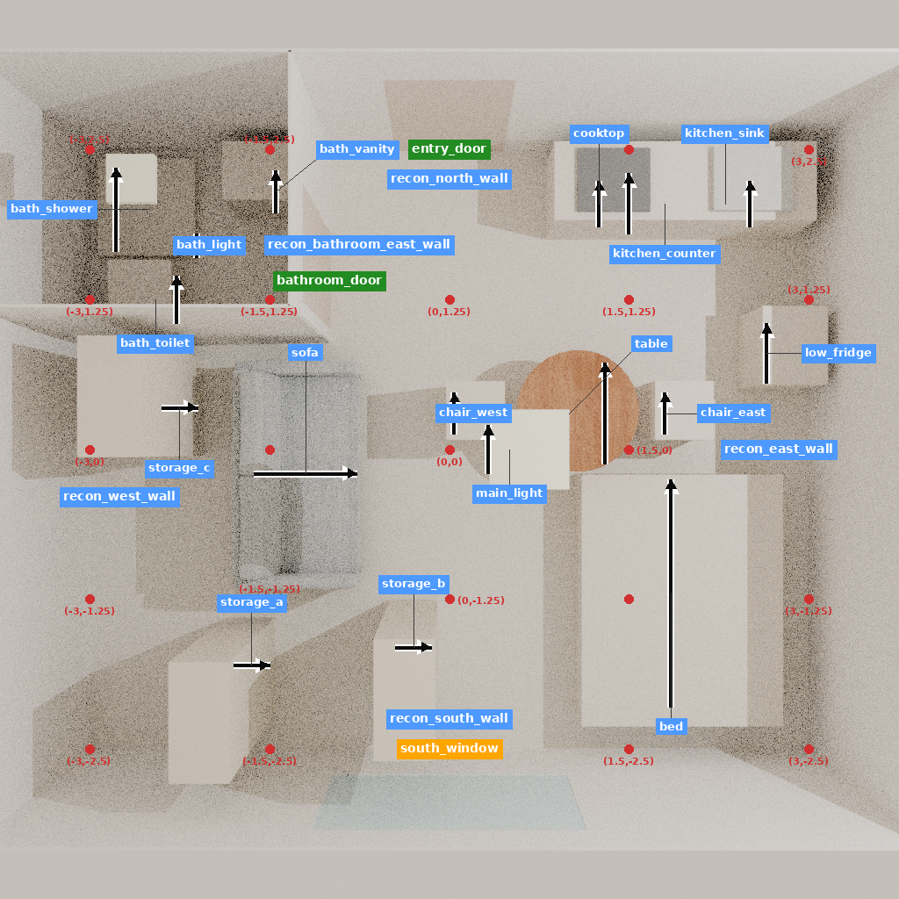
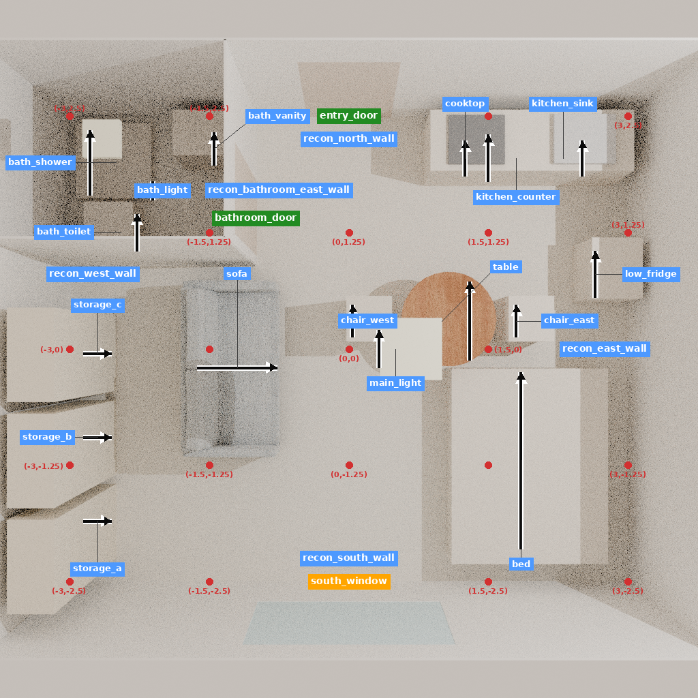

# 来源对应的收纳集中示范：初态修复后通过声明的几何条件

这条记录已完成“来源理由 → 研究者构造的条件 → 对象与实际动作 → 前后房间 → 后果与未知项”的连接。五次原生移动后，三种声明身体包络下，活动接近点从 **6/7** 增至 **7/7**，柜前采样从 **10/15、5/15、5/15** 增至 **15/15**，起居区域空地增加 **0.82 m²**。26个对象全部保留，23个非目标对象逐字段不变，三柜保持实例身份与尺寸。

这是**来源指导、研究者重建的条件几何正向示范**。不是原设计师的操作轨迹，不是模型生成，不是整屋专业推荐，也不是训练收益。五步属于一条决定，不是五个独立项目。

## 来源、输入与可表达范围

[Richard Guilbault 的建筑师项目说明](https://www.archdaily.com/623445/30m2-flat-in-paris-richard-guilbault) 介绍约30平方米住宅的空间重组及多用途储物、技术墙。本研究只迁移“将收纳集中到一侧，减少对主要活动区的占用”这一部分。原项目设备整合、施工、四窗采光及完整住宅功能均未复现。

6×5×2.6米房壳、西北卫浴、单窗、家具位置及活动点都是研究者假设；与AIR沿用同一结构模板。三件0.8×0.4×2.2米柜体是静态外包络，无内部容量或柜门。沙发、餐桌使用固定缓存网格，其他家具和灯具为明确标注的代理。来源家族在04:00:13 UTC已分配为未来训练来源候选；这不授予训练权限。

上一版STORAGE-v1的入口附近家具使初态所有活动点不可达，尽管局部空地增加，仍被拒绝作为正向设计示范。本版在06:28:10 UTC独立冻结一个修订输入：调整沙发、桌、两椅和第三柜的位置，相应固定起居与餐位接近点；全体对象和尺寸保留。先验六项已有活动可达，再执行同样的集中策略。第二柜的中间路径也已事前调整以绕开新沙发位置。**两版输入不同，不能作为算法效果对照。** 原失败完整保留，未覆写、未重抽结果。

`SOURCE_RECORD.json`是冻结时复制的知识入库快照，其中尚未执行的字段不是当前成熟度。当前来源对应见`SOURCE_MAPPING.json`、`DECISION_PACKET.json`和`SUPERVISION_QUALIFICATION.json`。

## 实际结果及过程代价

| 状态 | 活动点可达数，分母7 | 柜前采样可达数，分母15 | 起居区空地 m² | 最大轴对齐空矩形 m² |
|---|---|---|---:|---:|
| 初态 | 6 / 6 / 6 | 10 / 5 / 5 | 5.706282 | 3.2256 |
| 第一次移动后 | 6 / 6 / 6 | 10 / 5 / 5 | 6.026282 | 3.2256 |
| 第二次移动后 | 7 / 7 / 7 | 5 / 5 / 5 | 6.065649 | 4.1072 |
| 第三次移动后 | 7 / 7 / 7 | 5 / 5 / 5 | 6.064011 | 4.1072 |
| 第四次移动后 | 7 / 7 / 7 | 10 / 10 / 10 | 6.346282 | 4.7872 |
| 第五次移动后 | 7 / 7 / 7 | 15 / 15 / 15 | 6.526282 | 4.7872 |

三个数依次对应0.4、0.5、0.6米方形身体，假设净高1.8米、2厘米网格和门叶全开。六个保护点为床边、起居、两餐位、厨房及卫浴；第七点是窗前。柜前是每柜五个声明正面采样，不能等同于真实柜门操作或内部取用。

终态无保护点损失，但第二、第三步使0.4米场景的柜前采样暂时从10降至5；第三步的局部空地略降。全部中间状态保留，不能把每一步分别标成单调改善。实际工具存在微小位姿偏差，量测使用实际状态而非请求坐标。

初态和所有实际端点无正体积AABB交叠或越界；五段平面扫掠通过声明的几何模型。该工具执行放置，并不模拟人搬运；重量、摩擦、手部操作、安装、安全及舒适度未知。三种身体宽度不等于房间与资产尺寸稳健性，后者本轮未测试。

## 证据与监督用途

- `INPUT_CHECK_PLAN.json`、`INPUT_CHECK.json`、`BUILT_INPUT_CHECK.json`：唯一输入在原生执行前通过六点覆盖，构建变换误差≤4.45e-16。
- `FROZEN_PROGRAM.json`、`PREFLIGHT.json`、`STEPS.json`：冻结的五步与真实回执、实际位姿及扫掠；无模型选择或候选搜索。
- `SUMMARY.json`：六个状态的绝对覆盖与空地指标，严格覆盖规则通过；不再以零到零的不退化验收。
- `DECISION_PACKET.json`、`SUPERVISION_QUALIFICATION.json`：完整来源对应与可支持的正向几何范围，未知项单列。
- `OBJECTIVE_REVIEW.json`、`QA_EPISODE_CANDIDATE.json`：客观后果评审，整体专业偏好仍为证据不足；不是新增真人评价。
- `ota_candidates/`：五个真实动作候选，各绑定动作前对象表、当时量测和五视图，上一回执只使用实际已发生的回执。未来结果只放评价字段。它们属于同一决定，未新跑官方加载器、未准入训练。

来源知识、条件几何示范、专业偏好和训练授权分别记录。缺少人评不抹去这里已验证的几何监督，也不能据此补写整屋专业标签。下一步是把真实逐步上下文接入同材料分开／配对的加载器核验；本例停止调位，不扩大为反复搜索一个房间。主算法对照仍须给两组同样真实的知识与动作，错配理由仅为辅助诊断。

## 执行、查看与恢复

原生回放于06:35:00.853258 UTC启动、06:39:33.245391 UTC结束，272.392141秒，实际退出0；5次调用、6次观察、30图、28项原生检查。输入检查0.517446秒，构建5.735572秒，预检0.517280秒，汇总0.918909秒，两次导出各2.725秒，均退出0。实际命令、首日志和退出状态见`execution/*/receipt.json`。本轮无下载、模型推理或训练。

前后GLB各42个几何节点，导出回读最大边界差≤1.16e-7米。初态导出房间与实际原生初态逐字段相同；五个检查点逐payload校验，最终检查点没有另做一次原生冷恢复。最终五视图均直接查看，图中静态白色包络必须按代理理解。

服务器运行目录：`/data/wyh/scene_cvpr_20261020/design_decisions_920/runtime/P920-STORAGE-v2_20261105T062810Z/`。完整可编辑检查点在`replay/checkpoint_5/`；可查看三维文件为`export_initial/room_geometry.glb`和`export_after/room_geometry.glb`。400个服务器文件及225,966,679字节的逐项哈希在`SERVER_FILES.json`。Git保留必要状态、量测、回执、代码与六张俯视图；权重、大型网格及完整检查点留服务器。

恢复时使用归档的`code/native_project.py`验证检查点manifest，再以固定原生环境调用`import_project(source, fresh_destination)`导入新目录；不覆盖旧运行。源资产版本与哈希见`BUILD_PLAN.json`，实际使用代码见`CODE_LOCK.json`、`ANALYSIS_CODE_LOCK.json`及`code/`。恢复或重现仍需本机相应资产访问条件，不能从Git假称包含了原始授权网格。
